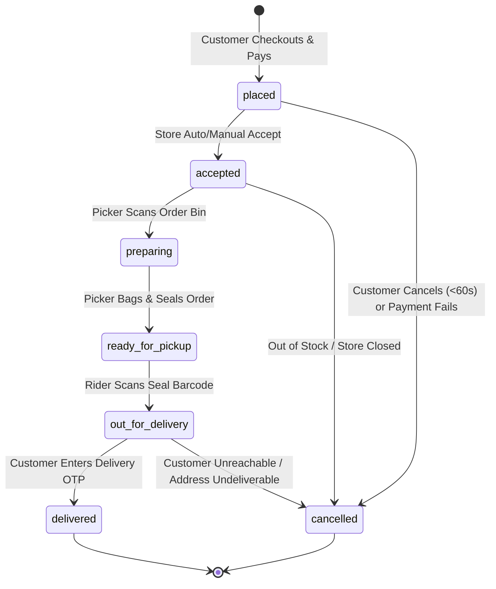
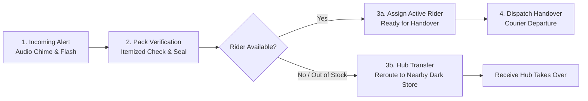

# Belzo — Product Requirements Document (PRD)
**Project Name:** Belzo Hyperlocal Quick-Commerce Ecosystem  
**Document Version:** 1.0.0  
**Target Release:** Production v1  
**Document Owner:** Principal Software Architect & Tech Lead  
**Last Updated:** September 2026  

---

## 1. Executive Summary & Vision

### 1.1 Vision Statement
Belzo is an ultra-fast, hyperlocal quick-commerce platform delivering essentials and lifestyle goods to urban consumers within 10 to 20 minutes. Built around distributed micro-fulfillment centers ("Dark Stores") and an agile, technology-driven courier fleet, Belzo unifies lightning-fast procurement, intelligent order routing, real-time tracking, and automated fulfillment across six primary retail verticals.

### 1.2 Core Value Propositions
- **For Customers:** Sub-20-minute delivery guarantee, curated catalog quality, frictionless single-tap checkout, and live millimeter-accurate courier telemetry.
- **For Delivery Partners (Riders):** Transparent per-order payouts, peak-surge incentives, streamlined single-hand application UX, and automated batching.
- **For Dark Store Managers & Admins:** Live inventory synchronization, predictive stock replenishments, SLA breach alarms with audio alerts, and unified fleet orchestration.

---

## 2. Core Verticals & Product Offerings

Belzo operates across 6 distinct commercial verticals from dedicated zones within each dark store:

| # | Vertical | Catalog Characteristics | Fulfillment SLA | Special Constraints |
|---|---|---|---|---|
| 1 | **Grocery** | Staples, dairy, baked goods, snacks, beverages | 10–15 Mins | Temperature control for dairy/frozen items |
| 2 | **Fruits & Vegetables** | Daily farm-fresh produce, herbs, organic cuts | 10–15 Mins | Weight-variance tolerance (±5%), shelf-life decay tracking |
| 3 | **Food & Restaurant** | Ready-to-eat meals, quick bakery bites, hot beverages | 15–25 Mins | Thermal insulation bags, spill-proof packaging requirements |
| 4 | **Medicine & Healthcare** | OTC drugs, wellness supplements, first aid, baby care | 10–15 Mins | Schedule-H prescription upload & validation flags |
| 5 | **Fashion** | Basics (tees, socks, innerwear, rainwear, umbrellas) | 15–20 Mins | Strict barcode-scanned return/exchange protocols |
| 6 | **Electronics** | Cables, chargers, adapters, power banks, audio buds | 15–20 Mins | Serial number logging, tamper-proof security seal verification |

---

## 3. Multi-Role System & Identity Architecture

Belzo enforces a **Single Unified Authentication Gateway** using phone-number One-Time Password (OTP) verification powered by Supabase GoTrue Auth. The system automatically categorizes users into roles upon successful verification.

```mermaid
flowchart TD
    A[User Enters Mobile Phone Number] --> B[Supabase GoTrue OTP Dispatch]
    B --> C[User Enters 6-Digit SMS OTP]
    C --> D{Verify OTP}
    D -- Invalid --> C
    D -- Valid --> E[Lookup `public.profiles` by `auth.uid()`]
    E --> F{Profile Role Check}
    F -- role == 'customer' (default) --> G[Route to (customer) Tab Navigator]
    F -- role == 'rider' & is_verified == true --> H[Route to (rider) Console Navigator]
    F -- role == 'rider' & is_verified == false --> I[Show Rider Onboarding Pending Screen]
    F -- role == 'admin' --> J[Prompt Web Admin Portal SSO / MFA]
    F -- No Record Found --> K[Create Profile with role = 'customer'] --> G
```

### 3.1 Role Definitions & Privileges
1. **Customer (`customer`):**
   - Self-registered via mobile app.
   - Ability to search catalog, maintain addresses, manage cart, place orders, track couriers, rate deliveries, and contact support.
2. **Rider (`rider`):**
   - Pre-onboarded and verified by Belzo Operations via the Admin Portal.
   - Tied to specific Dark Store hubs.
   - Mobile app displays the dedicated **Rider Console** for order acceptance, pickup confirmation, navigation, and delivery proof capture.
3. **Store Manager / Dispatcher (`store_operator`):**
   - Web console access restricted to their assigned Dark Store.
   - Manages picking/packing pipeline, inventory stock-ins, and local order dispatch.
4. **Super Admin (`admin`):**
   - Full read/write access across all Dark Stores, catalog items, pricing rules, financial settlements, customer service logs, and analytics.

---

## 4. Detailed Functional Specifications

### 4.1 Customer Mobile Application (20 Production Screens)

```
(customer)/
├── splash
├── (auth)/
│   ├── phone-login
│   └── otp-verify
├── location-picker
├── (tabs)/
│   ├── home
│   ├── categories
│   ├── search
│   ├── offers
│   └── profile
├── product-listing
├── product-details
├── cart
├── address-book
├── checkout
├── payment-gateway
├── order-confirmation
├── live-tracking
├── order-history
├── order-detail
├── wishlist
├── support-center
└── notifications
```

#### Screen-by-Screen Functional Requirements:
1. **Splash Screen:** Animated Belzo wordmark & gradient eagle wing; initializes Supabase session, checks local cache, fetches dark store status, routes to auth or home.
2. **Phone Login Screen:** Clean phone input with country code picker (`+91`), auto-focus, Terms of Service agreement, and reCAPTCHA Enterprise background verification.
3. **OTP Verification Screen:** 6-digit auto-read OTP input box (WebOTP / SMS Retriever API), 30-second resend countdown timer, and automatic submission upon completion.
4. **Location Selection (GPS / Map Pin):** Interactive map with draggable pin, reverse-geocoding via Mapbox/Google Maps, saved address quick-pills (Home, Work, Other), and serviceability zone check against nearest dark store polygon.
5. **Home Screen:**
   - Top Header: Current active address with dropdown toggle, delivery SLA badge (`⚡ 12 Mins`).
   - Sticky Search Bar with animated vertical placeholder ("Search milk, bread, earphones...").
   - Promo Carousel: High-res banners with deep links to categories/discounts.
   - 6 Core Verticals Grid: Circular cards with brand gradient borders.
   - Dynamic Sections: "Flash Deals", "Frequently Bought Together", "Trending in your Area", "Recently Ordered".
   - Persistent Floating Cart Pill (visible when cart count > 0).
6. **Categories Screen:** Dual-pane category browser (Vertical selector on left sidebar, subcategories and product grids on right content view).
7. **Product Listing Screen (PLP):** Filter drawer (Brand, Price range, Dietary type, In-stock only), sorting dropdown (Relevance, Price Low-High, Fastest Delivery), multi-column product card with quantity steppers.
8. **Product Details Screen (PDP):**
   - High-resolution Cloudflare R2 image carousel with pinch-to-zoom.
   - Title, brand, unit size (e.g., `500 ml`, `Pack of 2`), discounted price, MRP strikethrough, discount badge (`28% OFF`).
   - Stock status tag ("Only 3 left in stock" if stock < 5).
   - Expandable accordions: Product Description, Nutrition/Spec Table, Storage Guidelines, Return Policy.
   - Similar items horizontal carousel.
9. **Search Screen:** Debounced auto-suggest (150ms delay), recent search chips with single-tap delete, trending keywords, and voice-search integration.
10. **Offers & Deals Screen:** List of active promo codes, minimum order requirements, maximum discount ceilings, "Copy Code" button, and bank/UPI payment discounts.
11. **Cart Screen:**
    - Item list with quantity steppers and delete swipe action.
    - Dark Store distance & delivery SLA confirmation.
    - Delivery instructions text area (e.g., "Don't ring bell", "Leave at door").
    - Delivery tip pills (`₹20`, `₹30`, `₹50`, `Custom`).
    - Detailed Bill Breakdown: Item Total, Packaging Charges, Delivery Fee, Surge Fee (if weather/peak), Tip, Total Savings, Grand Total.
    - Cancellation policy disclosure.
12. **Address Selection & Management Screen:** List of saved addresses with default indicator, "Add New Address" form with house/flat number, floor, landmark, and receiver phone number.
13. **Checkout Screen:** Final order summary, selected address verification, delivery speed slot (Instant vs Scheduled), and payment method selection.
14. **Payment Gateway Screen:** Seamless selection between Cash on Delivery (COD), UPI Direct Intent (GPay, PhonePe, Paytm), Credit/Debit Cards (Stripe / Razorpay SDK), and Netbanking.
15. **Order Confirmation Screen:** Celebratory Lottie confetti animation, generated order reference number (`#BLZ-89213`), estimated delivery time countdown, and "Track Order" CTA.
16. **Live Order Tracking Screen:**
    - Real-time map displaying Dark Store origin, live Rider GPS coordinate marker (rotating based on bearing), and Customer destination pin.
    - Polyline route with ETA recalculation.
    - 4-Stage visual timeline: Placed ➔ Packing ➔ On the Way ➔ Delivered.
    - Rider Profile card: Name, vehicle number, masked phone call button, delivery OTP display (`4912`).
17. **Order History Screen:** Chronological listing of past orders with status badges, thumbnail arrays, total bill, "Reorder All" button, and "Download Invoice" action.
18. **Order Details Screen:** Deep-dive into past order invoice, item-by-item price, payment transaction ID, rating/review submission for products and rider.
19. **Wishlist / Saved Items Screen:** Grid of saved products with immediate "Move to Cart" stepper and stock availability indicator.
20. **Help & Support Screen:** FAQ knowledge base, recent order issue picker ("Items missing", "Package damaged", "Late delivery"), and real-time live chat ticket support.
21. **Notifications Center Screen:** Notification feed categorised into Order Updates, Promotional Offers, and System Alerts with mark-as-read toggles.

---

### 4.2 Rider Mobile Application (9 Production Screens)

```
(rider)/
├── login
├── dashboard
├── order-alert-modal
├── active-order-details
├── navigation-view
├── pickup-verification
├── delivery-completion
├── earnings-summary
└── rider-profile
```

#### Screen-by-Screen Functional Requirements:
1. **Rider Login:** Restricted phone login with company-verified credential verification.
2. **Dashboard Screen:**
   - Prominent Online/Offline toggle switch with GPS pre-check.
   - Shift metrics header: Today's Earnings (`₹1,240`), Completed Trips (`9`), Acceptance Rate (`96%`).
   - Assigned Dark Store status & current queue position.
3. **New Order Alert Modal:**
   - Full-screen audible alert overlay.
   - 30-second countdown circular timer ring.
   - Pickup location (Store name & distance), Drop location (Customer neighborhood & distance).
   - Guaranteed earnings badge (`₹65.00`).
   - "Swipe to Accept" slider and "Decline" button.
4. **Active Order Details Screen:**
   - Status header with current milestone.
   - Dark Store picking bin reference (e.g., `Bin #B-14`).
   - Itemized packing manifest to cross-verify package count.
   - Customer notes (e.g., "Gate code 4490, beware of dog").
5. **Navigation View (In-App / External Launch):**
   - High-contrast turn-by-turn map view with dark mode optimization.
   - Direct button to launch Google Maps / Apple Maps / Waze with deep-linked coordinate parameters.
6. **Pickup Verification Screen:**
   - Camera barcode scanner to scan the seal bag barcode printed by the Dark Store.
   - "Confirm Bags Picked" action button transitions status to `out_for_delivery`.
7. **Delivery Completion Screen:**
   - 4-digit Customer Delivery OTP verification input.
   - Optional customer signature capture pad.
   - Optional photo proof of delivery (required for contact-less "Leave at Door" requests).
   - "Confirm Delivery" trigger marks order `delivered` and credits rider wallet.
8. **Earnings & Payout Summary Screen:**
   - Interactive weekly earnings bar chart.
   - Detailed trip history ledger with base pay, distance pay, surge bonus, and tips.
   - Payout bank account display with "Request Payout" button.
9. **Rider Profile & Vehicle Settings Screen:**
   - Rider ID, rating score (e.g., `4.92 ★`), registered vehicle details (make, license plate).
   - KYC documents validity status (Driving License, Insurance).
   - Emergency SOS panic button (triggers immediate SMS with live coordinates to dispatch).

---

### 4.3 Web Admin Portal (11 Production Modules)

```
apps/admin/
├── (dashboard)/
│   ├── overview
│   ├── live-orders (with Web Audio chime)
│   ├── catalog/
│   │   ├── products
│   │   └── categories
│   ├── inventory/
│   │   ├── dark-stores
│   │   └── stocks
│   ├── fleet/
│   │   ├── riders
│   │   └── live-map
│   ├── customers
│   ├── finance/
│   │   ├── payments
│   │   └── settlements
│   ├── marketing/
│   │   └── coupons
│   └── analytics/
│       └── reports
```

#### Module-by-Module Functional Requirements:
1. **Executive Dashboard Metrics:** Real-time GMV, Order Velocity (Orders/Min), Active Fleet Count, Average Delivery Time SLA (Target: 14.5 mins), and Gross Margin % across stores.
2. **Live Order Pipeline (Order Monitor):**
   - Realtime WebSocket Kanban board (`Placed`, `Packing`, `Ready for Pickup`, `Dispatched`, `Delivered`).
   - **Audio Chime System:** HTML5 Web Audio synthesis generating an audible ding on every incoming `placed` order until acknowledged by store operators.
   - One-click manual override to reassign riders or cancel orders with penalty logging.
3. **Product Catalog Management:**
   - Full CRUD table with instant search and inline price/discount editing.
   - Bulk CSV / Excel importer and exporter for master catalog updates.
   - Cloudflare R2 direct drag-and-drop multi-image uploader.
4. **Categories & Verticals Manager:** Tree-structure management for the 6 core verticals, subcategories, banner associations, and display sorting.
5. **Dark Store & Warehouse Hubs:** Configuration of dark store polygons, operational hours, active radius (km), picking staff assignments, and store-level disable toggles.
6. **Inventory & Stock Control:** Real-time SKU stock levels by dark store, low-stock threshold triggers, automated Purchase Order (PO) generators, and batch expiry trackers.
7. **Riders & Fleet Management:** Rider onboarding verification, KYC document approval, vehicle inspection records, duty log audits, and real-time fleet map tracking.
8. **Customers Management (CRM):** Customer directory, lifetime order value, wallet adjustments, customer service ticket histories, and fraud block/unblock controls.
9. **Payments & COD Settlements:** Daily Cash-On-Delivery reconciliation ledger, payment gateway dispute management, rider cash deposit audit, and automated payouts.
10. **Offers, Coupons & Loyalty Engine:** Rule builder for percentage/flat discount coupons, first-order bonuses, cart threshold validations, and targeted category vouchers.
11. **Reports & Analytics:** Heatmaps of delivery densities, customer retention cohort matrices, SKU velocity reports, and SLA breach root-cause analyses.

---

## 5. State Machine & Order Lifecycle



### State Machine Transition Rules:
| Current State | Next State | Triggering Actor | Pre-Conditions | Actions Executed |
|---|---|---|---|---|
| `*` | `placed` | Customer | Payment confirmed (or COD chosen), stock reserved | Order record created, push notification to Store, Audio chime plays in Admin |
| `placed` | `accepted` | Store Operator / System | Dark store active, inventory lock valid | Order acknowledged, assigned to Dark Store picking queue |
| `accepted` | `preparing` | Store Picker | Picker claims order in terminal | Picker item checklist loaded, items scanned from shelves |
| `preparing` | `ready_for_pickup` | Store Picker | All items scanned into tamper-proof bag | Bag sealed with QR/barcode, rider dispatched via assignment algorithm |
| `ready_for_pickup`| `out_for_delivery` | Rider | Rider at store, scans bag QR/barcode | Rider linked to order, customer notified with live tracking & delivery OTP |
| `out_for_delivery`| `delivered` | Rider + Customer | Rider enters valid 4-digit OTP provided by customer | Order completed, payment captured, rider payout credited, review prompt sent |
| Any (pre-pickup)  | `cancelled` | Customer / Store | Within 60 seconds of order or store stockout | Reversal of payment/hold, inventory unlocked, notifications dispatched |

---

## 6. Non-Functional Requirements & Performance SLAs

- **Delivery Speed SLA:** 95% of orders delivered in under 18 minutes within a 3.5 km dark store radius.
- **App Cold Start Time:** < 1.8 seconds on 4G networks.
- **Search Response Time:** < 80 milliseconds (edge cached).
- **Live Location Updates:** Courier coordinates refreshed every 15–20 seconds with sub-5-meter Kalman filtering.
- **System Availability:** 99.95% uptime across database and edge functions.
- **Security & Privacy:** End-to-end HTTPS/TLS 1.3, encrypted phone numbers at rest, PCI-DSS compliant checkout (no card numbers stored locally), and strict Row-Level Security (RLS) enforcement.

---

## 7. Store Operator & Dispatch Terminal ("Ek Aadmi" Station)

### 7.1 Operator Role & Concept
The **Store Operator** is the dedicated on-ground store staff member ("ek aadmi") who acts as the operational heartbeat of a Belzo Dark Store micro-fulfillment center. Operating via an iPad/tablet or rugged desktop terminal at the packing station, the operator coordinates incoming orders, picking and bagging verification, rider allocation, inter-store transfers, and local stock/price adjustments in real time.

### 7.2 Operational Workflow


1. **Incoming Order Alert:**
   - Visual alert banner and synthesized ambient Web Audio chime (`AudioContext`) triggered on every new order `placed` event via Supabase Realtime CDC.
   - 60-second target acceptance threshold.
2. **Pack Verification:**
   - Order expanded with full itemized checklist (product name, variant/unit, barcode, quantity).
   - One-tap status transition to `ready_for_pickup`.
3. **Rider Allocation & Inter-Hub Rerouting:**
   - **Direct Rider Assignment:** Dropdown of real-time online delivery partners filtered by distance and vehicle type.
   - **Hub Transfer (Reroute):** When local items face sudden stockouts or local couriers are exhausted, the operator transfers the order to an adjacent Dark Store (`orders.store_id = target_store_id`, `transferred_from_store_id = current_store_id`), keeping the customer informed with updated ETA.
4. **Rapid Price & Stock Adjustment:**
   - **Inline Price Editor:** Instant click-to-edit price updates on `products.price` and `products.discount_price` with zero engineering intervention.
   - **Instant Stock Switch:** One-click toggling of `is_available` between In Stock and Sold Out during ground stock fluctuations.
   - **Quick Add Emergency Product:** Modal drawer enabling on-the-fly catalog expansion for locally sourced items.

